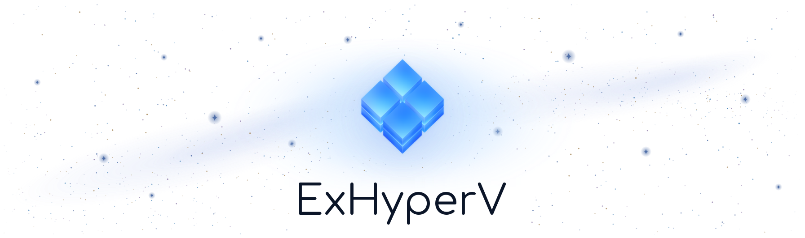

  <picture>
    <source media="(prefers-color-scheme: dark)" srcset=".github/assets/banner-dark.svg" />
    <source media="(prefers-color-scheme: light)" srcset=".github/assets/banner-light.svg" />
    
  </picture>

  A modern desktop experience for Hyper-V on Windows.

  
  
  
  
  

  

  <strong>English</strong> &nbsp;|&nbsp; <a href="README_zh.md">简体中文</a> &nbsp;|&nbsp; <a href="README_zh-TW.md">繁體中文</a>

