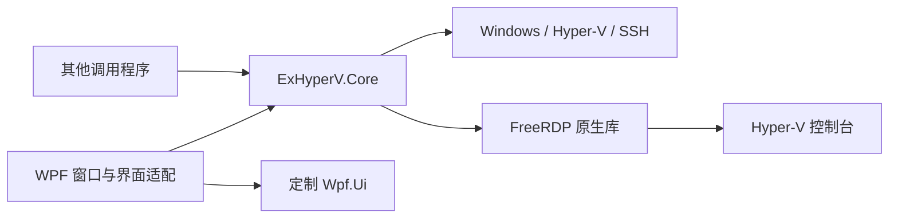
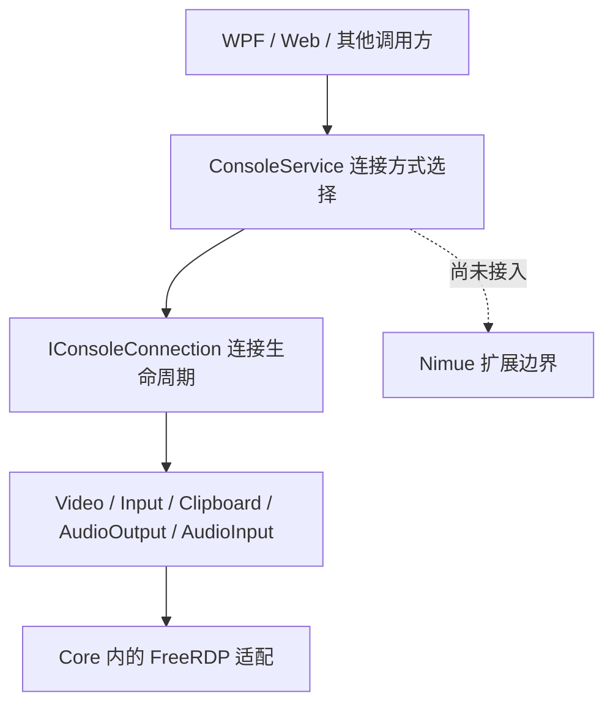

# 架构与维护约定

ExHyperV 2.0.0-Alpha 分为 WPF 桌面程序和 Core 管理库，均以 .NET 10 为目标。构建入口是 `src/ExHyperV.sln`；构建环境见 [项目说明](../README_zh.md)，自动检查见 [测试说明](../src/ExHyperV.Core.Tests/README.md)。

## 目录与职责

```text
src/
├─ ExHyperV.sln
├─ ExHyperV.Wpf/
│  ├─ UI/Pages/       页面、ViewModel 和各页面专用组件
│  ├─ UI/Windows/     主窗口、控制台窗口及其适配
│  ├─ UI/Shared/      共用转换器、行为、布局、图标和界面交互
│  ├─ Application/    配置、版本、外壳、任务栏和托盘管理
│  ├─ Assets/         界面资源
│  └─ external/wpfui/ 定制控件库源码
├─ ExHyperV.Core/
│  ├─ Models/         管理操作使用的数据和流程契约
│  ├─ Services/       主机、虚拟机、设备及部署流程
│  ├─ Tools/          系统调用和底层支持
│  ├─ Linux/          Linux GPU 部署素材
│  └─ external/freerdp/ 原生控制台实现与依赖包
├─ ExHyperV.Core.Tests/ Core 测试项目，只引用 Core
│  ├─ Diagnostics/    完整诊断入口与复用检查场景
│  └─ Tools/Catalog/  事务清单的源码核对工具
├─ ExHyperV.Wpf.Tests/ 保留的 WPF 检查，暂不纳入主解决方案
└─ Verify.ps1         整体离线验证入口
```



Core 是在调用程序进程内使用的工具箱 DLL，提供查询、修改、需用户决定的多步流程和有生命周期的连接/监控对象。它不引用 WPF、WinForms 或桌面项目，也没有统一的 Core 运行会话、后台服务进程或独立 Worker。

接口分类、调用约定和资源归属见 [Core API 参考](../src/ExHyperV.Core/API.md)；测试入口与执行方式见 [Core 测试项目](../src/ExHyperV.Core.Tests/README.md)。分类不改变目录分层，也不把公开辅助方法自动变成远程工具。

WPF 负责页面和窗口、绑定集合、图表、图像转换、系统剪贴板及用户决定的收集，也保留客户端策略：控制台模式选择、失败回退、重连、布局、分辨率重试，主题与语言偏好、更新入口和退出时机。内存缺测时的显示摘要、GPU 活跃图标等显示推断也在界面侧。因此，“Core 可独立调用”不等于“所有程序策略都在 Core”。

GPU 部署的步骤、判定、状态与清理由 Core 管理；界面读取状态并提交选择。取消会等待当前原生调用返回，再阻止后续步骤并清理。该流程新建的适配器只有在能唯一识别时才会被删除；清理失败可以重试。

页面专用代码就近放置，共用界面机制归 `UI/Shared`。`VirtualMachinesPageViewModel` 的多个 partial 文件仍组成同一个类。定制 Wpf.Ui 通过项目引用自动构建，来源和接入差异记录在其 `source.json`；正常编译使用已提交字体，不需要重新生成。

## 数据与生命周期

| 范围 | 当前约定 |
| --- | --- |
| 宿主调度器 | `GetSchedulerType` 只返回当前运行值，优先读取经布局校验的内核字段，失败或未知时仅接受本次启动的事件；无法确认则返回 Unknown。内核字段未文档化，不作为根分区身份证明。`GetConfiguredSchedulerType` 单独读取 BCD，元素缺省时按当前系统产品类型及版本推定启动默认值；不表示当前已生效，也不保证其他启动条件变化后的运行值。亲和性按运行值选择后端，WPF 分别显示运行状态和启动配置。 |
| 虚拟机元数据 | `VmMetadataService` 通过 WMI 的 `HostOnlyItems`（Source=4）保存到虚拟机配置。`ExHyperV.OSType` 保存分类字符串；`ExHyperV.CpuAffinity` 在 Root 下保存编号数组，在 Classic/Core 下保存含 `Version=1`、`Backend="HcsCpuGroup"`、`LogicalProcessors` 的 JSON 对象，空处理器集合表示解除限制。HCS 标记与编号一并保存，Root 不将其当进程掩码位应用。每次只改指定键。业务模型和注册虚拟机接口不提供备注读写，不解析、迁移或清理旧备注标记；通用 VMCX 文件编辑仍允许处理 Notes 字段。导入预览读取同一份 HostOnlyItems。 |
| Classic/Core CPU 亲和性 | 通过微软公开 ComputeCore 接口读取真实 HCS LpIndex。每台虚拟机分别建组，不按相同处理器集合跨 VM 复用；已独享且处理器未变时保持原组。旧共享组在该 VM 保存亲和性时拆分，并复制原组已报告的四项策略值，不自动分摊共享配额；未知属性或不兼容的新拓扑明确失败。换组先写全零 GUID 解绑，再绑定本次新组；确认失败时恢复原绑定并仅清理本次新组，结果未知不补偿。成员核对限于 WMI 可见 VM，外部工具仍能改变绑定。宿主具名互斥量覆盖创建、策略复制、绑定、恢复及元数据保存。旧组不属于本次创建范围，换组或解绑后不自动删除。 |
| CPU 组策略 | `HostCpuGroupService` 按组查询及分别修改总 CPU 配额、调度优先级、空闲逻辑处理器保留数和相对调度权重。修改影响整个共享组；成员清单仅覆盖 WMI 可见的 Hyper-V 虚拟机。提交前核对版本摘要，沿用 CPU 亲和性的宿主协调锁；提交后回读，不自动重试或覆盖其他策略。相对权重属性尚无微软公开命名，解释依据底层调度实现；缺失时不补默认值。组策略不复制到各虚拟机的 HostOnlyItems，Root 调度器不提供这套 CPU 组管理能力。 |
| Root CPU 亲和性 | 沿用进程硬亲和性，仅支持实际单 Windows 处理器组和 64 位调用进程。使用系统活动掩码枚举处理器，空选择恢复系统允许掩码；不按处理器数量移位生成掩码。按 VM GUID 定位 vmmem，核验 PID、创建时间及所有者 SID，以同一安全句柄操作并回读。多组宿主在保存待应用偏好前也明确返回不支持。读取失败不冒充空选择，`ReadStateAsync` 分别返回实际值与启动偏好；`GetCpuAffinityAsync` 只返回实际值。 |
| Root 亲和性恢复 | 调用方在启动后调用恢复接口；WPF 在首次发现运行中的 VM、观察到停机后重新运行时请求一次，普通刷新和暂停恢复不重放。同一 VM 的保存和整轮启动恢复使用跨进程具名互斥量；五轮重试的固定等待共九秒，另加查询与操作耗时，手动保存排在旧轮之后。当前 Core 进程按 PID 与创建时间保存最近一次应用结果，同一进程实例的重复自动请求复用该结果，明确保存仍可执行；去重记录不跨进程共享，也不持有进程句柄。每轮核对保存偏好，只有进程明确尚未出现才重试；结果未知不自动重放。Core 不建立持续进程监督，WPF 不额外轮询始终显示运行中的 VM 是否替换了 vmmem；这种情况可由调用方再次调用恢复接口。 |
| IP 与创建默认值 | IP 来源冲突时优先使用宿主嗅探地址，再走既有回退。Core 创建磁盘允许省略目录，此时使用虚拟机目录。 |
| 配置与 MMIO | 继续共用 `%LOCALAPPDATA%/ExHyperV/Config.xml` 和已检测的 MMIO 上限。统一入口返回配置快照，在锁内重读、保留其他字段并完整写入后替换；不以默认值覆盖损坏文件。互斥限于同 Windows 登录会话、同规范化路径且使用此入口的调用者。 |
| 模型与语言 | 模型保留属性通知和显示辅助字段；内置系统/设备类型目录只读。默认语言跟随调用上下文，显式设置 `Resources.Culture` 会覆盖整个进程。旧字符串入口仍有保留字歧义。 |
| 缓存 | 查询缓存按实例和实际查询对象维护；宿主平台事实与成功检测的 MMIO 结果继续共享，不自动重新探测。磁盘元数据按文件属性失效，不能识别保留相同属性的所有外部修改。 |
| 虚拟磁盘元数据 | 本地文件的容量、类型和父盘关系使用 VirtDisk 公开接口，以 GetInfoOnly、ReadOnly、NO_PARENTS 读取，不挂载或修复磁盘。父盘失效时仍可读取子盘基础信息；父盘依赖必须解析成功，未确认不能当作独立盘。父链查询失败保留原生错误，删除保护保留无法排除依赖的磁盘。压缩包预览继续按流解析；元数据可读不等于全盘数据完整。 |
| GPU 显存 | 容量仅指 DXGI 的 DedicatedVideoMemory，不累加专用系统内存、共享内存或进程预算。以 LUID 经公开 D3DKMT 接口精确关联 PnP 实例，不按名称或枚举顺序匹配；同实例多条一致结果归并，冲突或无法关联时未知。联合适配器无法单独归属到物理卡时不分摊其总容量。模型 null 表示未取得，0 是有效容量；查询字段未知时为 Unavailable。没有注册表容量回退或厂商单位特判。 |
| 卷自动挂载 | 通过 Mount Manager 的 QUERY_AUTO_MOUNT / SET_AUTO_MOUNT 直接查询、设置并读回确认，不启动 mountvol 或从注册表推定运行状态。设置由系统持久保存，退出程序不还原。Core 写入与复核按宿主资源锁排队；写入后读回失败报告 OutcomeUnknown，读回值不一致报告 Conflict，原生错误码保留。 |
| ARP 与整体停止 | ARP 从宿主启动持续到真正退出，切页或隐藏到托盘不停止。通过微软公开 Packet Monitor API 建立本实例的独立会话和实时流，只过滤 ARP，不清空全局过滤器或停止其他进程的会话。要求管理员权限及系统提供相应公开接口；不可用时通过 `ArpSnoopService.LastFailure` 报告，IP 查询继续使用来宾上报和系统邻居缓存，不回退私有抓包接口。ARP 的关闭仍是进程内最终关闭。 |
| 宿主存储协调 | 使用主机范围的具名互斥量，同盘号、同映像文件身份的 Core 操作排队；不同资源可以并行。GPU 临时磁盘操作持锁至清理完成，物理盘恢复操作前的联机及只读状态，覆盖期间的外部状态修改；设备身份改变或无法核对时不修改替代盘。映像按卷和文件身份协调，避免同文件路径别名绕过锁；只卸载本次创建的临时挂载。锁不阻止外部工具直接操作硬件，强制终止或断电不保证恢复。 |
| PCIe 存储控制器 | 取得控制器及关联磁盘锁后重新核对身份，再连续执行脱机和转移；等待用户确认时不持锁。准备或转移失败会在锁内尝试恢复本次执行前的磁盘属性，覆盖期间的外部属性修改；恢复失败明确报告。成功转移属于用户要求的持久变更，不恢复成转移前归属。 |
| 存储选择身份 | 存储查询返回可序列化的 `SelectionToken`，移除时原样回传。Core 核对 VM、挂接、介质及物理盘身份，旧选择不能仅凭同一槽位移除替代对象；身份不完整或已变化时拒绝。摘要不是授权凭证；WMI 不提供原子比较删除，无法保证识别最终核对后的外部替换或完全相同配置的重建。 |
| 操作结果未知 | 已提交 WMI 调用超时、取消等待或无法确认终态时返回 `OutcomeUnknown`，不表示原生任务已停止。组合流程保留现场，不继续依赖该结果的回滚、重试或文件清理。原值恢复仍以之前采集值为目标，但磁盘在途操作尚未确认时先停止后续写入并报告。异常合同入口通过 `CoreOperationException.Result` 提供同一错误类别。无持久作业日志或自动接管；调用方须核对目标状态后再安排后续操作。 |
| 网卡两步创建 | 使用本次创建回执确认网卡和连接资源。初始化确认失败时自动撤销，先子资源后网卡；撤销失败或不能确认归属时保留并报告。结果分别列出网卡状态、初始化状态、设备 GUID、原错误和撤销错误。WPF 成功或失败后均刷新实际网卡清单。 |
| 导入使用与清理 | 单机及批次在准备、文件处理和原生操作期间保留资源；释放关闭新操作入口，取消后续步骤，等待在途使用退出，再清理工作资源，成功导入的 VM 保留。失败预览仍返回批次清理对象；已知清理失败允许重试，未知原生结果先重新核实本次作业及结果身份，无法确认则继续保留。WPF 保留失败对象并提供“重试清理”；此恢复入口只在原进程内有效，不包含崩溃恢复。 |
| 彻底删除依赖 | 按执行时最新清单判断，检查其他已登记 VM 和检查点的磁盘父链；父链只用于保护，不扩大删除候选。依赖无法查清时仍注销 VM、清理已确认专属配置，保留无法排除依赖的磁盘并返回保留路径及清理问题。配置清理不递归删除未知内容，仅清理已确认文件和空目录。未登记的离线差分盘不在自动发现范围；删除前复查身份和引用不构成对外部工具的原子保护。 |
| 监控与原生资源 | 监控实例停止接收新工作，取消排队更新并等待在途读取后释放；初始化失败回滚。共用 COM STA、成功加载的 VMCX/VMBus 和控制台原生模块保留到进程退出。 |
| 监控身份与缺测 | CPU 输出使用 GUID 并单列宿主；名称计数器只有唯一对应到 GUID 时采用。磁盘按完整路径或设备身份匹配，编码碰撞不猜测。CPU/GPU/网络/磁盘和内存均提供样本有效性及时间，缺测或失败不伪装成有效零值；WPF 保留最后有效数值及曲线，恢复有效采样后继续更新。内存两个字段、GPU 占用与活动检测分别报告；已确认关机、设备移除仍是实际变化。 |
| 退出与取消 | GUI 退出时等待监控收尾，不统一接管所有其他业务的退出策略。在途 WMI/原生调用须实际返回，取消令牌不能强制终止它们，因此没有固定退出耗时或共用模块热卸载保证。 |
| 预览功能开关 | `AzureFeatureSet` 的临时业务在跨进程锁内读取、修改并恢复原值；恢复原始存在性、注册表类型及内容，覆盖期间的外部修改，原先不存在才删除。读取原值失败不执行修改，恢复失败明确返回 `CleanupRequired` 并保留业务错误。没有启动/退出全局复位，强制终止或断电不保证恢复。 |

Core 的公开类型按当前源码使用，不提供历史名称别名。Linux 素材的本地目录和已发布下载地址是不同约定，移动本地目录时不要机械改写上游 URL。

## 控制台接口

调用方通过 `ConsoleService.GetBackends()` 列举连接方式，使用 `CreateConnection(options, backendId)` 获取 `IConsoleConnection`。`RdpBasic`、`RdpEnhanced`、`Nimue` 平级列出；目录和连接对象均使用 `BackendId`，默认选择 `RdpBasic`。前两个选项当前由 FreeRDP 实现。连接选项不再包含 `Enhanced` 开关。目录表示本版的接入范围，不探测宿主依赖或来宾健康。选择未知或尚未接入的方式会明确失败，不自动切换。



画面、输入、剪贴板和双向音频各有独立接口；连接的能力属性为 null 表示本次连接不支持，不能通过等待变为可用。基本会话提供画面和输入，增强会话另提供剪贴板和尺寸请求。剪贴板还须检查 `IsAvailable`；`SupportsResize` 只表示支持提出请求，不能代替通道或来宾的接受结果。音频契约已定义，但当前内置实现的 `AudioOutput` 和 `AudioInput` 都为 null。Nimue 的图像、输入、音频和剪贴板均未接入，不创建空连接或伪装成功；未来适配器放在 Core 内，独立商业组件的实现和授权不属于此库。

每条连接由调用方独立拥有。两个 FreeRDP 选项复用内部 `FreeRdpConsoleConnection`，直接实现中立能力接口；帧事件和租约保持不变，没有额外整帧复制。调用方通过中立入口消费画面、输入及剪贴板，不直接创建具体实现。FreeRDP 双架构原生包随 Core 嵌入，按内容哈希释放到应用缓存后加载，不依赖额外服务进程。

回调在后台线程执行，调用方应尽快返回，不能在回调中同步等待同一连接结束。`Dispose()` 请求停止，`DisposeAsync()` / `DisconnectAsync()` 等待清理完成；已关闭对象不能再次启动。输入方法返回 `false` 表示未接受，不能当作已经发送。分辨率请求被接受也不代表来宾已经切换尺寸，实际尺寸以画面为准。

`FrameReceived` 提供仅在本次回调中有效的 `ConsoleFrame` 借用。异步使用前调用 `Retain()`，用完后 `Dispose()`；持有的租约在连接关闭后仍有效。`Pixels` 是只读像素视图，访问期间必须保持租约存活，不能同时释放。需要长期独立保存时调用 `CopyPixels()`，才会生成托管快照。

画面按从上到下的 BGRA32 排列并包含远端光标。缓冲来自有界原生池，Core 传递引用，WPF 直接从租约内存更新位图；替换或显示完的帧及时归还。等待显示的旧帧及其变化区域会合并，序列不连续或尺寸变化时完整刷新。增强剪贴板支持 Unicode 文本、DIB 图像和 HTML，单格式最多 16 MiB、整体最多 32 MiB，尚不支持文件复制。WPF 仅在控制台画面聚焦时同步系统剪贴板。原生协议、构建及停止顺序见 [FreeRDP 说明](../src/ExHyperV.Core/external/freerdp/README.md)。

控制台工具栏的 `FPS` 开关显示接收帧率、WPF 位图更新完成的频率，以及更新间隔。统计默认关闭，按窗口启用；开启后每秒更新两次文字，用实际经过时间计算频率。读数不代表显示器扫描输出或远程连接宿主的帧率。静止画面的更新频率可以很低，不能单凭长间隔判定故障。

## VMCX 文件接口

Core 的 `Tools/Utilities/Vmcx.cs` 统一使用本机 Windows `VmDataStore.dll` 读取和提交现有 VMCX，不再包含自行解析或重写文件物理结构的实现。`VmcxDocument` 通过独立副本读取，`VmcxEditSession` 在内存中组织字段、子树与设备定义修改；整批内容先在原生临时存储中重建并读回核对，随后备份源文件、取得原生排他锁、再次核对源内容，通过 DLL 一次提交到原文件，最后重新打开验证。没有用临时 VMCX 替换原文件的步骤，也没有二进制后备路线。节点使用独立身份，允许同路径的 HostOnlyItems 容器；Notes 作为普通文件字段开放，不恢复旧业务标记。范围不包含从零创建 VMCX、VMGS、VMRS 或宿主设备分配。

导入预览、失效 GPU 扫描和 GPU 修复共用这套文件访问能力，保留 GPU 核心字段缺失检查。GPU 修复在确认关机、重新核对虚拟机身份和设备记录后，整批更新或删除设备并提交。文件锁定或发生并发修改时返回失败；提交故障保留备份并报告实际文件状态。

Core 调用系统目录中的 `VmDataStore.dll`，使用 `IKeyValueStore` 的前 33 个接口槽位。批量修改通过 `RemoveValue` 逐个清除旧容器后重建，文件头及数据版本由 DLL 维护。通用编辑支持整数、无符号整数、有限双精度、布尔、字符串和字节数组；创建 selector 限于单个字符串选择键，无法重建的节点形态在写入前拒绝。

## 已知限制与验证边界

- 控制台画面、键鼠、双向文字剪贴板、分辨率及定位有 ARM64 实机验证。基本会话在 1024×768 下经人工对照，拖动、滚动流畅度已接近 1.5.2。帧租约通路另有同配置的移动、滚动及整屏更新实机对照：减少了 CPU 时间和托管分配，画面接收频率保持同等水平；输入响应不能按资源降幅等比例推断。测量覆盖 Core 回调、WPF 位图更新和来宾输入应答，未覆盖屏幕扫描输出；其他分辨率、图片/HTML 剪贴板及 x64 真实连接尚未单独完成实机验证。
- 自动检查覆盖规则、替身流程、资源释放和部分界面样例，不能替代真实 GPU 驱动部署、VM/PCIe 操作、ARP 捕获、原生故障注入、长时间监控和完整应用退出测试。构建或离线检查通过也不等于所有设备路径可用。
- 裁剪图标字体仍缺少 `FullScreenMinimize24`。字体生成的字节一致性与图标使用是否完整是两项不同检查。

普通双架构单文件 EXE 需要对应架构的 .NET 10 桌面运行时；自包含安装包携带运行时。发布保留 SDK 生成的依赖布局。外部库源码、字体来源及许可证跟随各自目录维护。
